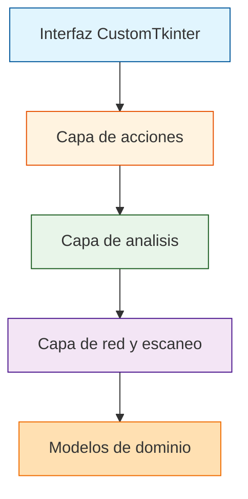

# IP Inspector — Escaner de Red y Puertos

<p align="center">
  <a href="https://github.com/Matthew-Garay/IP-Scanner/actions/workflows/ci.yml"></a>
  <a href="https://github.com/Matthew-Garay/IP-Scanner/security/dependabot"></a>
</p>

Aplicacion de escritorio para Windows que escanea la red local, detecta dispositivos, revisa puertos y audita su seguridad.

## Descripcion

Aplicacion de escritorio para Windows que escanea la red local: encuentra los dispositivos conectados, revisa que puertos TCP tienen abiertos, identifica modelo y sistema operativo de cada equipo y comprueba si su configuracion es segura.

Funciona sin conexion una vez instalado y no envia datos a ningun lado. Esta pensada para saber que hay en tu propia red sin montar un servidor ni instalar Kali.

La interfaz es estilo Advanced IP Scanner: tabla virtualizada de 6 columnas (Estado, IP, Nombre, MAC, Fabricante, Puertos) con modos Rapido (27 puertos comunes) y Completo (1-1024).

## Caracteristicas

- **Network Scan (principal):** descubre equipos y sondea los puertos TCP del 1 al 1024 (siempre los mismos, para poder comparar escaneos). Detecta tambien IPs de la VPN, no solo la tarjeta fisica.
- **Security Audit:** revisa TLS y HTTP de cada equipo y asigna una puntuacion de riesgo.
- **Tools y Quick Tools:** DNS, WHOIS, traceroute, calculo de subredes y grafica de latencia.
- **Inventory:** guarda lo visto y lo compara con una linea base para detectar equipos que aparecen o desaparecen.
- **Monitor:** revisa periodicamente si los equipos siguen respondiendo.
- **Interfaz bilingue** (espanol/ingles) con cambio en caliente; informes PDF y HTML en el idioma activo.

## Tecnologias utilizadas

- **Lenguaje:** Python 3.13+
- **GUI:** CustomTkinter
- **Red:** scapy, psutil, mac-vendor-lookup (lista OUI de fabricantes, se descarga y cachea en el primer uso)
- **Empaquetado:** PyInstaller (IP_Inspector.spec)

## Requisitos previos

- Windows (la app esta disenada para escritorio Windows).
- Python 3.13 o superior.
- Permisos de administrador para el sondeo de descubrimiento (sockets/ARP).

## Instalacion

```powershell
git clone https://github.com/Matthew-Garay/IP-Scanner.git
cd IP-Scanner
python -m venv .venv
.venv\Scripts\Activate.ps1
pip install -r requirements.txt
```

Dependencias: customtkinter, scapy, psutil y mac-vendor-lookup. netifaces se omite a proposito (no publica paquetes para Python 3.13).

## Uso

Ejecuta la aplicacion como administrador (sin ese permiso Windows bloquea los sockets del sondeo):

```powershell
python -m ip_inspector.main
```

**Pruebas:**

```powershell
python -m unittest discover -s tests -t . -v
```

**Compilar el ejecutable:**

```powershell
pip install pyinstaller
pyinstaller IP_Inspector.spec
# Resultado: dist\IP_Inspector.exe
```

## Arquitectura



## Estructura del proyecto

El codigo va en capas y cada una solo importa de las de abajo:

```
ip_inspector/
├── core/        # Motor: modelos, utilidades, sondeo, escaner, inventario
├── analysis/    # Interpretacion de hallazgos: riesgo, exposicion, informes
├── actions/     # Acciones sobre un equipo: abrirlo, despertarlo, exportarlo
├── nettools/    # Pestanas de herramientas y monitor
├── interface/   # Todo lo que toca tkinter (ui.py + theme.py + fasttable.py)
├── i18n.py      # Catalago bilingue
├── launcher.py  # Punto de entrada para PyInstaller
└── main.py      # Punto de entrada en desarrollo
```

Como core no importa la interfaz, el motor puede usarse sin pantalla. El trabajo largo corre en un hilo trabajador que entrega resultados por queue.Queue, y el hilo principal los consume con after() para no congelar la ventana.

## Uso responsable

Esto sondea equipos ajenos. Usalo solo en redes donde tengas permiso.

## Licencia

Proyecto educativo y de codigo abierto; puedes usarlo libremente con fines de aprendizaje y redes propias.

## Autor

Matthew Garay — [GitHub](https://github.com/Matthew-Garay)

## Contacto

<p align="center">
  <a href="mailto:1911.garay.perez@gmail.com"></a>
  <a href="https://www.linkedin.com/in/matthewgarayperez/"></a>
</p>
