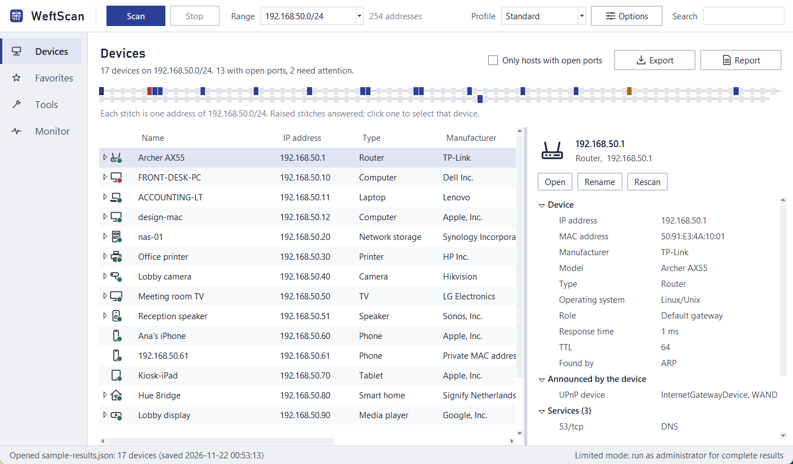
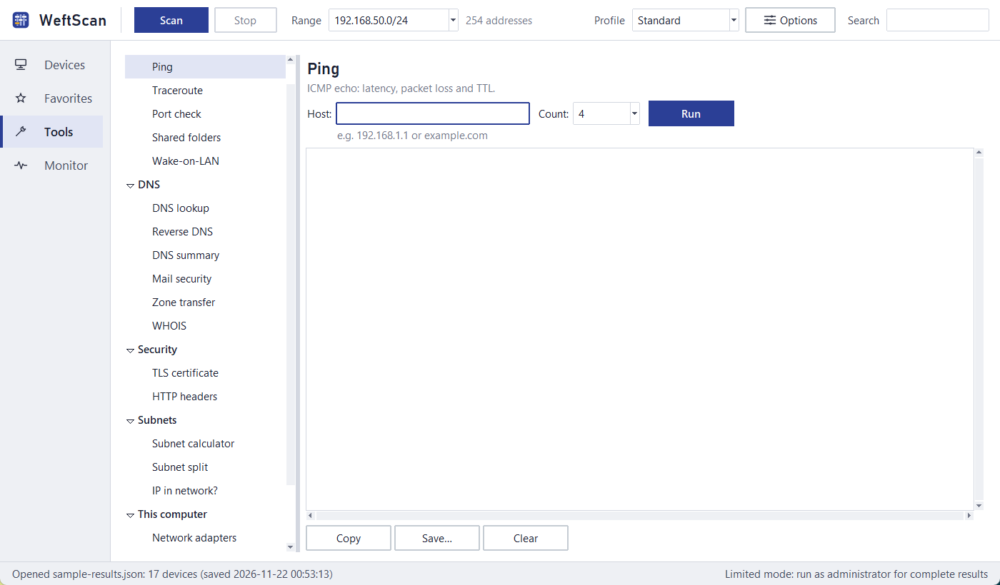

# WeftScan Network and Port Scanner



## A. Project Title and Executive Summary

WeftScan is a Windows desktop application that scans the local network, discovers connected devices, works out what each one is (computer, phone, printer, camera, TV, router...), checks open TCP ports, identifies models and operating systems, and audits each device's security posture. It also bundles everyday network diagnostics (ping, traceroute, DNS, WHOIS, TLS, subnet maths…) and a continuous host monitor. The problem it solves is giving visibility over the devices on a local network without installing complex tools or running a server. Its technological scope is local execution on Windows with Python 3.10+, with no data sent to external servers.

## B. System Architecture

The program follows a layered architecture where each layer only imports from the layers below it. The interface layer (Tkinter/ttk, using native Windows controls) talks to the user and sends requests to the actions layer. The actions layer coordinates with the analysis layer to interpret security findings. The analysis layer relies on the network and scanning layer to obtain device data. The network and scanning layer uses the domain models defined in the core layer. Data flows from the interface to the scanning engine, and results travel back the same way to be shown on screen. Long-running work runs on a worker thread that delivers results through a queue.Queue, and the main thread consumes them so the window never freezes. See [ARCHITECTURE.md](ARCHITECTURE.md) for details.

## C. Key Technical Features

- **Network scan:** host discovery (ARP sweep, ICMP and TCP probes) plus TCP port scanning, including VPN subnets.
- **Device identification:** listens to what devices announce about themselves over **SSDP/UPnP** (friendly name, manufacturer, exact model) and **mDNS/DNS-SD** (published services such as AirPlay, Google Cast or IPP printing), combines it with NetBIOS/DNS names, MAC vendors, randomized-MAC detection, open ports and the OS fingerprint, and sorts every host into one of 18 categories, each with its own icon: computer, laptop, server, router, access point, phone, tablet, printer, camera, TV, media player, speaker, game console, network storage, smart home, network device, this computer and unknown.
- **Address map:** a strip with one cell per address of the range, filled where a device answered and coloured by status; click a cell to jump to the device.
- **Scan profiles:** Quick, Standard (top ~100 ports), Full (1-1024), IoT / Cameras, Ping sweep only, and Custom port lists such as `22,80,443,8000-8100`.
- **Automatic range:** the app detects the network you are on and keeps the range up to date when you move to another network; a range you type yourself is kept.
- **Scan options:** network adapter selector, timeout, thread count, hostname resolution and model identification toggles.
- **Results:** sortable, multi-select grid (Ctrl+C copies rows for Excel) where each device expands to its services and **shared folders**, plus a details panel with everything known about the device, what it announced, its services and its security findings.
- **Change detection:** devices never seen before are flagged **NEW**, devices that stopped answering are listed as **gone** (Ctrl+D), and an optional **auto-rescan** (every 5-60 min) alerts you when something changes.
- **Your own names:** give any device a custom name and a note (F2); they follow its MAC address even when its IP changes. Favorites (★) are remembered between sessions.
- **Command line:** scan without the window and export to CSV/JSON, e.g. for scheduled tasks (see below).
- **Device actions (right-click or the Actions menu):** open with HTTP, HTTPS, FTP, Remote Desktop, SSH or shared folders; rescan, scan its /24 subnet, full 1-65535 port scan, ping, traceroute, TLS certificate, HTTP security headers; **power: Wake-on-LAN, remote shut down / restart / cancel** of Windows PCs; rename, favorites, copy. Several selected devices can be rescanned, woken or copied at once.
- **Tools tab:** Ping, Traceroute, Port check, Wake-on-LAN, DNS lookup, Reverse DNS, DNS summary, Mail security (SPF/DMARC/MX), Zone transfer, WHOIS, TLS certificate, HTTP headers, Subnet calculator, Subnet split, IP-in-network, Network adapters, ARP table, Listening ports and Local exposure.
- **Monitor tab:** continuous reachability checks with latency, uptime, loss statistics, an event log and an alert sound when a host goes down.
- **Files:** save results as CSV or JSON, **reopen saved JSON results** later (File › Open results), and HTML / PDF security reports.
- Remembers window size and position, recent address ranges and options; keyboard shortcuts for every main action.
- No persistent database and no network protocol of its own beyond local scanning; preferences live in `~/.weftscan/settings.json`.
- Responsible use: the tool probes other machines and must only be used with permission.

## D. Technology Stack Specification

| Category | Technology / Library |
|----------|----------------------|
| Language | Python 3.10+ (3.13 recommended) |
| GUI | Tkinter / ttk (standard library) with a custom flat theme and drawn icons |
| Networking | scapy, psutil, mac-vendor-lookup |
| Packaging | PyInstaller |
| Operating system | Windows |

## E. Installation, Configuration and Deployment Guide

### System prerequisites

- Windows 10 or 11 (the application is designed for the Windows desktop).
- Python 3.10 or later.
- Administrator rights for the full discovery sweep (raw sockets and ARP). Without them the app still works in a limited mode and offers *Settings › Restart as administrator*.

### Clone and install

```powershell
git clone https://github.com/Matthew-Garay/WeftScan.git
cd WeftScan
python -m venv .venv
.venv\Scripts\Activate.ps1
pip install -r requirements.txt
```

### Environment configuration

This project needs no .env file or environment variables.

### Running in development

```powershell
python -m weftscan.main
```

### Try it without scanning

Open `docs/sample-results.json` with **File › Open results** to explore the interface with a fictional small-office network.



### Command-line mode

```powershell
python -m weftscan 192.168.1.0/24 -p quick          # scan and print a table
python -m weftscan 10.0.0.1-50 --ports 22,80,443,8000-8100
python -m weftscan -o results.csv -o results.json   # local network, save both
python -m weftscan 192.168.1.0/24 --fail-on-risk 40 # exit code 3 if a host is risky
python -m weftscan --list-profiles
python -m weftscan --help
```

Without arguments, `python -m weftscan` opens the window.

### Keyboard shortcuts

| Key | Action |
|-----|--------|
| F5 / Esc | Start / stop the scan |
| Ctrl+R | Rescan the selected device |
| Ctrl+F | Filter the results |
| Ctrl+S / Ctrl+P | Export results / security report |
| Ctrl+T / Ctrl+M | Tools tab / Monitor tab |
| Ctrl+D / F2 | Changes since last scan / rename the selected device |
| Ctrl+O / Ctrl+C | Open saved results / copy selected rows |
| F8 / F9 | Scan options / details panel |

### Tests

```powershell
python -m unittest discover -s tests -t . -v
```

### Production build

```powershell
pip install pyinstaller
pyinstaller WeftScan.spec   # -> dist\WeftScan.exe
```

## F. Authorship Credits

Developed by: Matthew Ilveneff Garay Perez
Email: 1911.garay.perez@gmail.com
